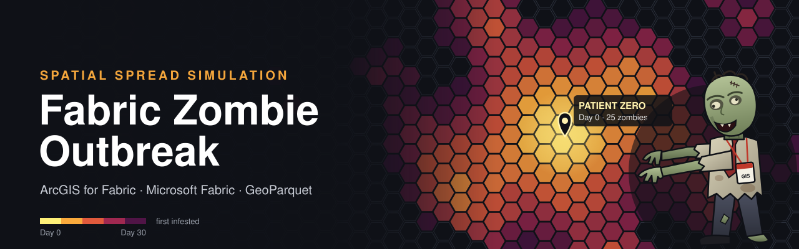

# Zombie Outbreak Spatial Spread Simulator

A PySpark notebook for **Microsoft Fabric** that uses **ArcGIS GeoAnalytics for Microsoft Fabric** to simulate how a zombie outbreak spreads geographically from a user-defined origin. The study area is tiled with H3 hexagons. Each cell gets a human population from US census tracts and a vulnerability profile from the CDC/ATSDR Social Vulnerability Index (SVI). The outbreak is then stepped forward day by day.

Results are written to OneLake as spatially clustered **GeoParquet**. They can optionally be published to **ArcGIS Online or ArcGIS Enterprise** as hosted feature layers.

> This is a teaching and demonstration project. The epidemiology is deliberately simple and the numbers are not predictions of anything real.

---

## Contents

- [How it works](#how-it-works)
- [Repository contents](#repository-contents)
- [Requirements](#requirements)
- [Quick start](#quick-start)
- [Running from a pipeline or another notebook](#running-from-a-pipeline-or-another-notebook)
- [Parameters](#parameters)
- [Outputs](#outputs)
- [Model details](#model-details)
- [Data sources](#data-sources)
- [Limitations and known issues](#limitations-and-known-issues)
- [References](#references)

---

## How it works

1. **Origin.** A point is created from `OUTBREAK_LAT` and `OUTBREAK_LON`.
2. **Grid.** Every H3 cell at `H3_RESOLUTION` that touches a geodesic circle of `STUDY_RADIUS_KM` around the origin is generated.
3. **Population and vulnerability.** Census tracts and SVI tracts are read from public ArcGIS feature services and joined on tract FIPS code. Tract population is split across H3 cells by area of overlap (areal interpolation).
4. **Neighbour graph.** Each cell is linked to every cell whose center lies within `NEIGHBOR_RADIUS_KM`, with weights that decay with distance.
5. **Daily simulation.** For `SIM_DAYS` days:
   - zombies wander to neighbouring cells;
   - small fractional arrivals are randomly rounded to whole zombies, so the outbreak front advances at a realistic pace;
   - within each cell, humans are bitten and zombies are destroyed, using an SZR-style model adjusted by the cell's vulnerability.
6. **Outputs.** GeoParquet tables are written to the attached Lakehouse, including per-cell daily states, arrival times and daily outbreak fronts.
7. **Optional publishing.** The GeoParquet outputs are pushed to ArcGIS Online as hosted feature layers.

---

## Repository contents

| File | Description |
|---|---|
| `Zombie_Outbreak_Spread.ipynb` | The Fabric notebook. Cell 2 is tagged as the parameters cell. |
| `README.md` | This document. |

### Notebook sections

| Section | Purpose |
|---|---|
| Parameters | All configurable inputs (see [Parameters](#parameters)). |
| 1. Setup and validation | Imports, parameter checks and run ID generation. |
| 2. Origin and H3 grid | Builds the study area and hexagon grid. |
| 3. Population and vulnerability | Reads tracts and SVI, computes indices, runs areal interpolation. |
| 4. Neighbour graph | Spatial join of cell centers to build movement edges. |
| 5. Simulation | Daily movement and infection loop. |
| 6. Output tables | Daily cell states, arrival times and outbreak fronts. |
| 7. GeoParquet write | Spatially clustered GeoParquet with bounding-box columns. |
| 8. Visual check | Arrival map and a spatial read-back test. |
| 9. Vulnerability analysis | Outcomes compared across vulnerability quintiles. |
| 10. Publish to ArcGIS Online | Optional hosted feature layer publishing. |

---

## Requirements

### Microsoft Fabric

| Requirement | Details |
|---|---|
| Fabric capacity | A workspace on Fabric capacity (trial or paid) that can run Spark notebooks. |
| Tenant setting | A Fabric administrator must enable **ArcGIS GeoAnalytics** in the tenant settings. |
| Spark runtime | **Fabric Runtime 1.3**. GeoAnalytics for Fabric is only available on this runtime. |
| Native Execution Engine | **Disabled** for the notebook's environment. GeoAnalytics does not currently support NEE. |
| Lakehouse | A Lakehouse attached to the notebook. Outputs are written under its `Files/` area. |
| Outbound internet | Spark must be able to reach `services.arcgis.com` and `services3.arcgis.com` to read population data, and your ArcGIS org URL if publishing. |

### ArcGIS (only needed for section 10)

| Requirement | Details |
|---|---|
| ArcGIS Online or Enterprise account | Must have privileges to create hosted feature layers (typically a Creator or GIS Professional user type with a publisher role). |
| Built-in account | Username and password sign-in works with built-in ArcGIS accounts only. Organizations that sign in through SAML or Microsoft Entra ID need the OAuth option in `register_gis` (`client_id` and `authorization_code`), which this notebook does not use yet. |
| Credits | Hosted feature storage in ArcGIS Online consumes credits. The `cells_daily` layer can be large. |

### Recommended

| Item | Why |
|---|---|
| Azure Key Vault | Store the ArcGIS password as a secret instead of typing it into the parameters cell. The identity running the notebook needs **Get** permission on secrets. |

### Geographic coverage

When `USE_REAL_POPULATION = True`, population and vulnerability data cover the **United States only**. For origins outside the US, set `USE_REAL_POPULATION = False` to use synthetic population, or substitute your own data sources.

---

## Quick start

1. Import `Zombie_Outbreak_Spread.ipynb` into your Fabric workspace (**Workspace → Import → Notebook**).
2. Attach a Lakehouse to the notebook.
3. Select an environment that uses **Runtime 1.3** with the **Native Execution Engine turned off**.
4. In the parameters cell, set `OUTBREAK_NAME`, `OUTBREAK_LAT` and `OUTBREAK_LON`.
5. Select **Run all**. With the default settings (150 km radius, H3 resolution 7, 30 days), expect roughly 14,000 cells.
6. Find the outputs in the Lakehouse under `/zombie_outbreak/run_id=<RUN_ID>/`.
7. Optionally, set `PUBLISH_TO_AGOL = True` and fill in the `AGOL_*` parameters to publish hosted feature layers.

---

## Running from a pipeline or another notebook

Because the parameters cell is tagged, any parameter can be overridden at run time. The example below calls the notebook from another notebook:

```python
notebookutils.notebook.run(
    "Zombie_Outbreak_Spread", 3600,
    {
        "OUTBREAK_NAME": "380 New York St, Redlands, CA",
        "OUTBREAK_LAT": 34.0564,
        "OUTBREAK_LON": -117.1956,
        "SIM_DAYS": 45,
        "PUBLISH_TO_AGOL": True,
        "AGOL_ORG_URL": "https://myorg.maps.arcgis.com",
        "AGOL_USERNAME": "gis_publisher",
        "AGOL_KEY_VAULT_URL": "https://my-vault.vault.azure.net/",
        "AGOL_PASSWORD_SECRET": "agol-password",
    },
)
```

In a Fabric Data pipeline, add a **Notebook** activity and set the same names under **Base parameters**. Parameters that hold dictionaries (`*_JSON`) are passed as JSON strings, because pipeline parameters only support simple types.

---

## Parameters

All parameters live in the notebook's parameters cell. Rates are **per simulated day** unless stated otherwise.

### Outbreak origin

| Parameter | Type | Default | Description |
|---|---|---|---|
| `OUTBREAK_NAME` | string | `"Patient Zero - Atlanta, GA"` | Label for the outbreak, stored with the origin and used in ArcGIS item descriptions. |
| `OUTBREAK_LAT` | float | `33.7490` | Latitude of the first reported case, in decimal degrees (WGS84, EPSG:4326). Valid range −90 to 90. |
| `OUTBREAK_LON` | float | `-84.3880` | Longitude of the first reported case, in decimal degrees (WGS84). Valid range −180 to 180. |
| `OUTBREAK_START` | ISO 8601 string | `"2026-10-31T00:00:00"` | Date and time of day 0. Each output row's `timestamp` is this value plus `day` days. |
| `INITIAL_ZOMBIES` | float | `25.0` | Number of zombies placed in the origin's H3 cell on day 0. |

### Simulation extent and resolution

| Parameter | Type | Default | Description |
|---|---|---|---|
| `SIM_DAYS` | int | `30` | Number of days to simulate. Day 0 (the initial state) is also written, so outputs contain `SIM_DAYS + 1` days. |
| `H3_RESOLUTION` | int (0–10) | `7` | H3 grid resolution. Resolution 7 cells average about 5.2 km²; resolution 8 cells average about 0.74 km², giving roughly seven times as many cells. Higher resolutions increase runtime sharply. |
| `STUDY_RADIUS_KM` | float | `150` | Radius of the geodesic circle around the origin. Every H3 cell that touches it is simulated. Zombies cannot spread beyond this area. |
| `NEIGHBOR_RADIUS_KM` | float | `6.0` | Cells whose centers are within this distance of each other can exchange zombies. Larger values allow longer daily journeys and create more neighbour links. Should be at least about twice the cell spacing (about 2.4 km at resolution 7). |

### Epidemiology

| Parameter | Type | Default | Description |
|---|---|---|---|
| `INFECTION_RATE` | float | `0.90` | **β (beta).** Humans converted to zombies per effective contact per day. Multiplied by each cell's `beta_mult`. |
| `ZOMBIE_KILL_RATE` | float | `0.35` | **α (alpha).** Zombies destroyed by humans per effective contact per day. Multiplied by each cell's `alpha_mult`. The ratio β/α roughly sets how explosive the outbreak is. |
| `ZOMBIE_MOBILITY` | float (0–1) | `0.10` | Fraction of each cell's zombies that wander to neighbouring cells each day. Controls how fast the front advances. |
| `ZOMBIE_DECAY_RATE` | float | `0.01` | Fraction of zombies that fall apart each day, independent of humans. |
| `STOCHASTICITY` | float (≥ 0) | `0.30` | Standard deviation of the lognormal noise applied to daily infections. `0` makes infections deterministic (movement rounding is still random). |
| `INFESTED_THRESHOLD` | float | `1.0` | Minimum zombies for a cell to count as *infested*. Used for arrival times, outbreak fronts and status labels. |
| `OVERRUN_FRACTION` | float (0–1) | `0.50` | Zombie count as a share of the cell's original population at which a cell is labelled *overrun*. |

### Population

| Parameter | Type | Default | Description |
|---|---|---|---|
| `USE_REAL_POPULATION` | bool | `True` | `True` uses US census tract population and SVI. `False` uses synthetic population (`DEFAULT_DENSITY_KM2` with random variation) and no vulnerability. |
| `TRACTS_URL` | URL | Esri USA Census Tracts, layer 0 | Feature service layer providing tract boundaries and population counts. |
| `TRACTS_SR` | int (WKID) | `4326` | Native spatial reference of `TRACTS_URL`. Used to build the extent filter, so it must match the layer. |
| `SVI_URL` | URL | CDC/ATSDR SVI 2022 USA, layer 2 (tracts) | Feature service layer providing SVI tract attributes. |
| `SVI_SR` | int (WKID) | `3857` | Native spatial reference of `SVI_URL`. |
| `POPULATION_SOURCE` | string | `"tract_2022"` | Which population count to distribute across cells. Options are listed below. |
| `DEFAULT_DENSITY_KM2` | float | `60.0` | Mean people per km² for synthetic population when `USE_REAL_POPULATION = False`. |

**`POPULATION_SOURCE` options**

| Value | Source field | Meaning |
|---|---|---|
| `tract_2022` | Tracts `POPULATION` | Esri 2022 total population. |
| `tract_2020` | Tracts `POPULATION_2020` | 2020 Census total population. |
| `svi_acs` | SVI `E_TOTPOP` | 2018–2022 American Community Survey population estimate. |
| `svi_daytime` | SVI `E_DAYPOP` | LandScan 2020 estimated **daytime** population. Simulates an outbreak during working hours, when people are concentrated in business districts. |

If the selected field is missing for a tract, the notebook falls back to `POPULATION`, then to 0.

### Vulnerability

Vulnerability is built from SVI **national percentile** fields (`EPL_*`), which run from 0 (least vulnerable) to 1 (most vulnerable). SVI's missing-value code (−999) is treated as null and skipped.

| Parameter | Type | Default | Description |
|---|---|---|---|
| `VULNERABILITY_MODE` | string | `"custom"` | `custom`: build the contact and escape indices from the weights below (recommended). `svi_overall`: use SVI's overall ranking `RPL_THEMES` for both indices. `none`: no vulnerability effect. |
| `CONTACT_WEIGHTS_JSON` | JSON string | `{"EPL_CROWD": 1.0, "EPL_MUNIT": 1.0, "EPL_GROUPQ": 1.0}` | Weights for the **contact index**: how densely people are packed together. A higher index raises the bite rate. |
| `ESCAPE_WEIGHTS_JSON` | JSON string | `{"EPL_AGE65": 1.0, "EPL_DISABL": 1.0, "EPL_NOVEH": 1.0, "EPL_AGE17": 0.5, "EPL_MOBILE": 0.5}` | Weights for the **escape/defence index**: how hard it is for people to flee or fight back. A higher index raises the bite rate and lowers the zombie kill rate. |
| `CONTACT_EFFECT` | float (0–1) | `0.40` | Maximum change to the bite rate from the contact index. `0.4` means ±40% at the 0th and 100th percentiles. |
| `ESCAPE_EFFECT` | float (0–1) | `0.40` | Maximum change to the bite rate from the escape index. |
| `DEFENSE_EFFECT` | float (0–1) | `0.40` | Maximum change to the zombie kill rate from the escape index. |

Weights must be non-negative and must name SVI `EPL_` fields. Each index is a weighted mean of the available percentiles for the tract.

**SVI fields used by default**

| Field | Index | Meaning |
|---|---|---|
| `EPL_CROWD` | Contact | Percentile of occupied housing units with more people than rooms. |
| `EPL_MUNIT` | Contact | Percentile of housing in structures with 10 or more units. |
| `EPL_GROUPQ` | Contact | Percentile of persons in group quarters (dorms, prisons, nursing homes and similar). |
| `EPL_AGE65` | Escape | Percentile of persons aged 65 and older. |
| `EPL_DISABL` | Escape | Percentile of civilian non-institutionalized population with a disability. |
| `EPL_NOVEH` | Escape | Percentile of households with no vehicle available. |
| `EPL_AGE17` | Escape | Percentile of persons aged 17 and younger. |
| `EPL_MOBILE` | Escape | Percentile of mobile homes. |

**Other SVI percentiles you can add:** `EPL_POV150` (below 150% of poverty), `EPL_UNEMP` (unemployment), `EPL_UNINSUR` (uninsured), `EPL_LIMENG` (limited English), `EPL_SNGPNT` (single-parent households), `EPL_HBURD` (housing cost burden) and `EPL_NOHSDP` (no high school diploma).

> **Design note.** The default custom indices deliberately exclude SVI's racial and ethnic minority theme (`RPL_THEME3`, `EPL_MINRTY`). Unlike crowding or lacking a vehicle, minority status has no plausible mechanism for making someone easier for a zombie to catch. Including it would encode a correlation as a cause. `svi_overall` mode does include that theme, because `RPL_THEMES` is SVI's composite of all four themes.

### Reproducibility and output

| Parameter | Type | Default | Description |
|---|---|---|---|
| `RANDOM_SEED` | int | `42` | Seed for the random number generators. Spark's random functions depend on data partitioning, so results are repeatable on the same cluster configuration but may differ slightly across configurations. |
| `OUTPUT_ROOT` | string | `"Files/"` | Root output folder, relative to the attached Lakehouse. |
| `RUN_ID` | string | `""` | Identifier for this run. Blank generates `YYYYMMDDTHHMMSS_xxxxxx`. Set it to an existing run's ID to republish that run with section 10. |
| `PARTITION_REGION_RES` | int | `4` | Coarse H3 resolution used to group rows spatially within files. Must be lower than `H3_RESOLUTION`. |
| `TARGET_FILES_PER_DAY` | int | `4` | Approximate number of files written per day partition of `cells_daily`. |

### ArcGIS Online publishing

| Parameter | Type | Default | Description |
|---|---|---|---|
| `PUBLISH_TO_AGOL` | bool | `False` | Set to `True` to run section 10. |
| `AGOL_ORG_URL` | URL | `"https://YOURORG.maps.arcgis.com"` | Your ArcGIS Online organization URL, `https://www.arcgis.com`, or an ArcGIS Enterprise portal URL such as `https://gis.example.com/portal`. |
| `AGOL_USERNAME` | string | `""` | ArcGIS username (built-in account) used to publish. |
| `AGOL_PASSWORD` | string | `""` | ArcGIS password. Leave blank to read it from Key Vault (recommended). A password typed here is saved in the notebook and may appear in pipeline run history. |
| `AGOL_KEY_VAULT_URL` | URL | `""` | Azure Key Vault URL, for example `https://my-vault.vault.azure.net/`. Used when `AGOL_PASSWORD` is blank. |
| `AGOL_PASSWORD_SECRET` | string | `""` | Name of the Key Vault secret that holds the ArcGIS password. |
| `AGOL_LAYERS` | string | `"front_daily,arrival,origin,grid_population_vulnerability,cells_daily"` | Comma-separated list of output tables to publish. |
| `AGOL_WRITE_MODE` | string | `"create"` | `create`: new hosted feature layers. `overwrite`: replace layer 0 of existing services. `append`: add features to layer 0 of existing services. |
| `AGOL_EXISTING_SERVICES_JSON` | JSON string | `'{}'` | Required for `overwrite` and `append`. Maps table name to feature service URL, for example `{"arrival": "https://services.arcgis.com/<id>/arcgis/rest/services/<name>/FeatureServer"}`. Tables without a URL are skipped. |
| `AGOL_SERVICE_PREFIX` | string | `"zombie_outbreak"` | Prefix for new service names. Services are named `<prefix>_<table>_<RUN_ID>`, because service names must be unique within an organization. |
| `AGOL_TAGS` | string | `"zombie,outbreak,simulation,h3,fabric"` | Comma-separated tags added to new items. |
| `AGOL_CELLS_DAILY_EVERY_N_DAYS` | int | `1` | Publishes only every Nth day of `cells_daily`, plus the final day, to keep the hosted layer small. `1` publishes every day. |
| `AGOL_MAX_PARALLELISM` | int | `6` | Maximum concurrent writers when uploading features. Lower it if you hit rate limits. |

---

## Outputs

All tables are written under `<OUTPUT_ROOT>/run_id=<RUN_ID>/` in GeoParquet format.

### Storage layout and spatial optimization

- **Spatial clustering.** Rows are range-partitioned and sorted by a coarse H3 region (`region_id`) and then by the fine H3 cell ID. Each Parquet row group therefore covers a compact area.
- **Bounding-box columns.** Every table includes `bbox_xmin`, `bbox_ymin`, `bbox_xmax` and `bbox_ymax`. Any Parquet reader (Spark, DuckDB, Polars and others) can use their min/max statistics to skip row groups outside a query window, whether or not it understands GeoParquet metadata.
- **Partitioning.** `cells_daily` is partitioned by `day`.
- **Geometry columns.** Each table has one geometry column in WGS84 (EPSG:4326). Secondary geometries are stored as WKT text (`*_wkt`).

### Tables

| Table | Grain | Geometry | Description |
|---|---|---|---|
| `cells_daily` | cell × day | `cell_geom` (polygon) | Simulation state for every cell the outbreak has touched (Z > 0 or R > 0), for every day. |
| `arrival` | cell | `cell_geom` (polygon) | First day each cell became infested, and its peak zombie count. Useful for arrival-time (isochrone) maps. |
| `front_daily` | day | `front_geom` (polygon) | Union of all infested cells per day, with summary statistics and spread speed. |
| `grid_population_vulnerability` | cell | `cell_geom` (polygon) | Static inputs for every cell: population, density and vulnerability. |
| `origin` | 1 row | `geometry` (point) | The outbreak origin. |

### Common cell attributes

These appear in `cells_daily`, `arrival` and `grid_population_vulnerability`.

| Column | Type | Description |
|---|---|---|
| `h3_id` | long | H3 cell index. Written as text when published to ArcGIS. |
| `region_id` | long | Parent H3 index at `PARTITION_REGION_RES`, used for clustering. |
| `area_km2` | double | Geodesic cell area. |
| `population` | double | Humans assigned to the cell at day 0. |
| `density_km2` | double | `population / area_km2`. |
| `county`, `state` | string | County and state of the tract covering most of the cell's population. |
| `main_tract_fips` | string | 11-digit FIPS code of that tract. |
| `dist_from_origin_km` | double | Geodesic distance from the cell center to the origin. |
| `contact_idx` | double | Population-weighted contact index (0–1). Null when no SVI data is available. |
| `escape_idx` | double | Population-weighted escape/defence index (0–1). |
| `svi_overall` | double | Population-weighted SVI `RPL_THEMES`, included for reference. |
| `beta_mult` | double | Multiplier applied to `INFECTION_RATE` in this cell. |
| `alpha_mult` | double | Multiplier applied to `ZOMBIE_KILL_RATE` in this cell. |
| `center_wkt` | string | Cell center point as WKT. |
| `bbox_xmin` … `bbox_ymax` | double | Bounding box of the row's geometry. |
| `run_id` | string | Run identifier. |

### `cells_daily` additional columns

| Column | Type | Description |
|---|---|---|
| `day` | int | Simulation day (0 = initial state). |
| `timestamp` | timestamp | `OUTBREAK_START + day`. Enable time on this field in ArcGIS to animate the outbreak. |
| `N` | double | Original human population of the cell. |
| `S` | double | Susceptible humans remaining. |
| `Z` | double | Active zombies. |
| `R` | double | Cumulative zombies destroyed or decayed ("removed"). |
| `zombie_share` | double | `Z / N`. |
| `status` | string | `overrun` (share ≥ `OVERRUN_FRACTION`), `infested` (Z ≥ `INFESTED_THRESHOLD`), `cleared` (Z below the threshold, R > 0) or `trace`. |

### `arrival` additional columns

| Column | Type | Description |
|---|---|---|
| `first_infested_day` | int | First day the cell reached `INFESTED_THRESHOLD`. |
| `peak_zombies` | double | Maximum zombie count the cell reached. |

### `front_daily` columns

| Column | Type | Description |
|---|---|---|
| `day`, `timestamp` | int, timestamp | Simulation day and date. |
| `front_geom` | polygon | Union of all infested cells that day. |
| `hull_wkt` | string | Convex hull of infested cell centers, as WKT. |
| `mean_center_wkt` | string | Mean center of infested cells, as WKT. |
| `infested_cells` | long | Number of infested cells. |
| `total_zombies` | double | Sum of Z across infested cells. |
| `zombies_destroyed` | double | Sum of R across infested cells. |
| `front_reach_km` | double | Farthest infested cell from the origin. |
| `spread_km_per_day` | double | Change in `front_reach_km` since the previous day. |

### ArcGIS Online layers

When published, each table becomes its own hosted feature layer. Two adjustments are made automatically:

- **64-bit integers become text.** Columns such as `h3_id` and `region_id` are converted to strings, because feature services store 64-bit integers as doubles, which would corrupt H3 IDs.
- **WKT columns are dropped.** Each layer keeps only its main geometry.

---

## Model details

### Daily update

For each cell, every day:

**1. Movement.** Each cell sends a share of its zombies, set by mobility (μ), to its neighbours. Neighbour weights decay exponentially with distance (scale `NEIGHBOR_RADIUS_KM / 2`) and are normalized so a cell's outflow sums to 1.

$$Z_m = (1-\mu)\,Z + \sum_{j \in \text{neighbours}} \mu\, Z_j\, w_{j \to i}$$

**2. Stochastic rounding.** If $Z_m < 1$, it becomes 1 with probability $Z_m$, otherwise 0. This stops fractional zombies from leaking across the whole grid instantly, so the front advances at a finite, realistic speed.

**3. Interactions.** These use a frequency-dependent contact term:

$$C = \frac{S \cdot Z_m}{\max(S + Z_m,\ 1)}$$

$$\text{new infections} = \min\!\big(S,\ \beta \cdot \beta_{mult} \cdot C \cdot \varepsilon\big), \quad \varepsilon \sim \text{Lognormal}(-\sigma^2/2,\ \sigma)$$

$$\text{destroyed} = \min\!\big(Z_m,\ \alpha \cdot \alpha_{mult} \cdot C + \delta \cdot Z_m\big)$$

$$S' = S - \text{new infections}, \qquad Z' = Z_m + \text{new infections} - \text{destroyed}, \qquad R' = R + \text{destroyed}$$

Here σ is `STOCHASTICITY` and δ is `ZOMBIE_DECAY_RATE`. The noise term ε has a mean of 1.

### Vulnerability multipliers

Each index is converted to a deviation from the national median, running from −1 to +1:

$$d_c = 2\,(\text{contact\_idx} - 0.5), \qquad d_e = 2\,(\text{escape\_idx} - 0.5)$$

$$\beta_{mult} = \max\big(0.05,\ (1 + \text{CONTACT\_EFFECT}\cdot d_c)(1 + \text{ESCAPE\_EFFECT}\cdot d_e)\big)$$

$$\alpha_{mult} = \max\big(0.05,\ 1 - \text{DEFENSE\_EFFECT}\cdot d_e\big)$$

Cells with no SVI data use the median (0.5), so their multipliers are 1.

### Areal interpolation

Each H3 cell is intersected with the tracts it overlaps. It receives each tract's population in proportion to the overlapping area:

$$\text{pop}_{cell} = \sum_{t} \text{pop}_t \cdot \frac{\text{area}(cell \cap t)}{\text{area}(t)}$$

Cell indices are population-weighted means across the overlapping tract pieces. Esri's tract boundaries are clipped to the coastline, so cells over water get zero population. Zombies can still wander through them.

---

## Data sources

| Dataset | Publisher | Used for |
|---|---|---|
| [USA Census Tracts](https://services.arcgis.com/P3ePLMYs2RVChkJx/ArcGIS/rest/services/USA_Census_Tracts/FeatureServer/0) | Esri; U.S. Census Bureau | Tract boundaries and population (`POPULATION`, `POPULATION_2020`). |
| [CDC/ATSDR Social Vulnerability Index 2022 – tracts](https://services3.arcgis.com/ZvidGQkLaDJxRSJ2/ArcGIS/rest/services/CDC_ATSDR_Social_Vulnerability_Index_2022_USA/FeatureServer/2) | CDC/ATSDR Geospatial Research, Analysis, and Services Program (GRASP) | Vulnerability percentiles, ACS population and LandScan daytime population. |

Cite the U.S. Census Bureau and CDC/ATSDR when sharing results. Full SVI variable definitions are in the [CDC SVI 2022 documentation](https://www.atsdr.cdc.gov/place-health/media/pdfs/2024/10/SVI2022Documentation.pdf).

---

## Limitations and known issues

- **US only** when real population is used.
- **Not validated against real data.** This is an illustrative model, not a calibrated epidemiological forecast.
- **No human movement.** Humans do not flee, evacuate or commute. Only zombies move.
- **No barriers.** Rivers, mountains and highways do not affect movement. Zombies cross water cells freely.
- **Closed study area.** Zombies that would leave the study radius are effectively lost.
- **Feature-service extent filter.** If the extent filter returns no rows, the notebook falls back to downloading the full national layer, which is slower but still works.
- **Separate ArcGIS items.** Each output table is published as a separate item rather than as layers of a single service.
- **Authentication.** Username and password publishing supports built-in ArcGIS accounts only.
- **Runtime constraints.** GeoAnalytics for Fabric requires Runtime 1.3 with the Native Execution Engine disabled.

### Ideas for extension

- Human flight away from infested cells, weighted by `EPL_NOVEH`.
- Movement barriers from water bodies or terrain, using a friction surface.
- Faster spread along road networks.
- An incubation period (an SEZR model).
- Military or quarantine zones that raise `alpha_mult` inside a polygon.
- Multiple outbreak origins.

---

## References

- Munz, P., Hudea, I., Imad, J., & Smith?, R. J. (2009). *When zombies attack!: Mathematical modelling of an outbreak of zombie infection.* In *Infectious Disease Modelling Research Progress*, Nova Science Publishers.
- Alemi, A. A., Bierbaum, M., Myers, C. R., & Sethna, J. P. (2015). *You can run, you can hide: The epidemiology and statistical mechanics of zombies.* Physical Review E, 92(5).
- [ArcGIS GeoAnalytics for Microsoft Fabric documentation](https://developers.arcgis.com/geoanalytics-fabric/)
- [ArcGIS GeoAnalytics for Microsoft Fabric tutorials (Learn ArcGIS)](https://learn.arcgis.com/en/paths/arcgis-geoanalytics-for-microsoft-fabric-tutorials)
- [Microsoft Learn: ArcGIS GeoAnalytics for Microsoft Fabric](https://learn.microsoft.com/fabric/data-engineering/spark-arcgis-geoanalytics)
- [H3 hexagonal grid system](https://h3geo.org/)
